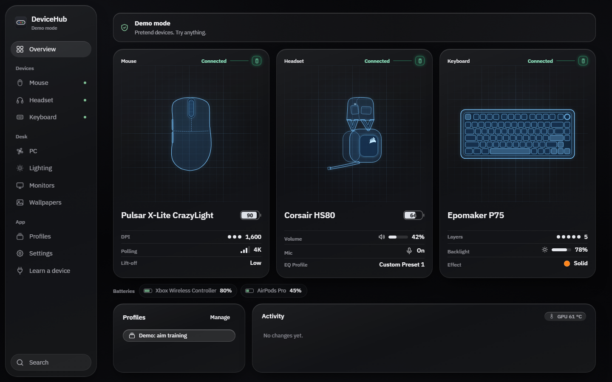
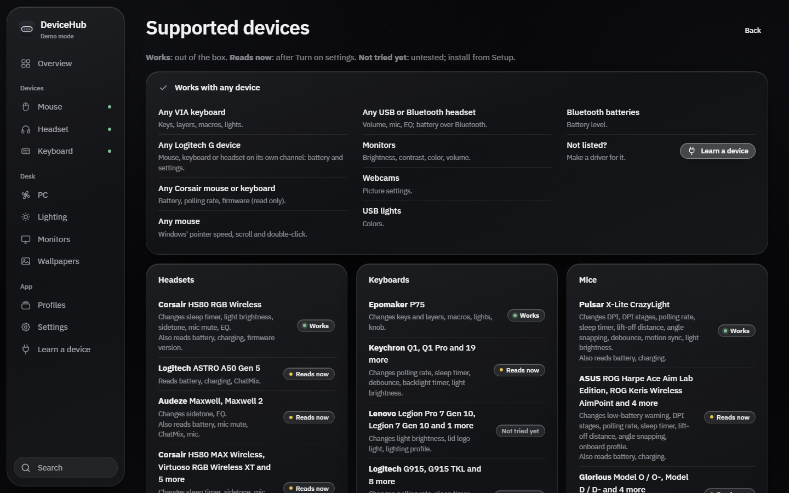
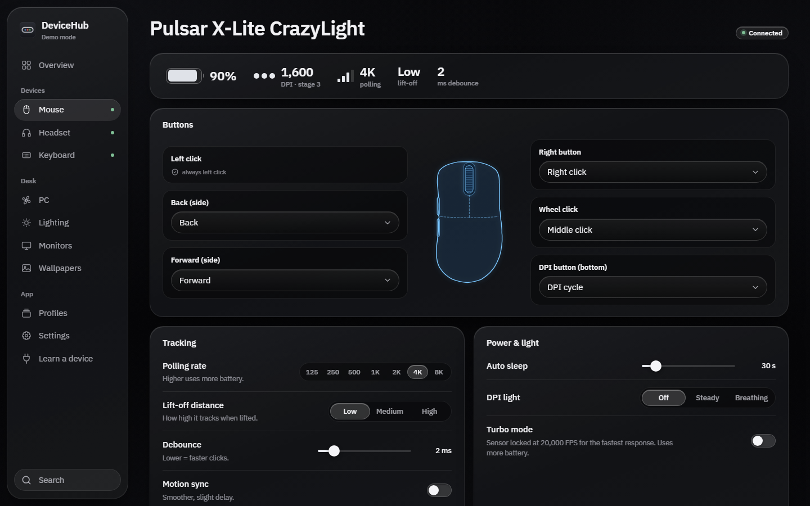
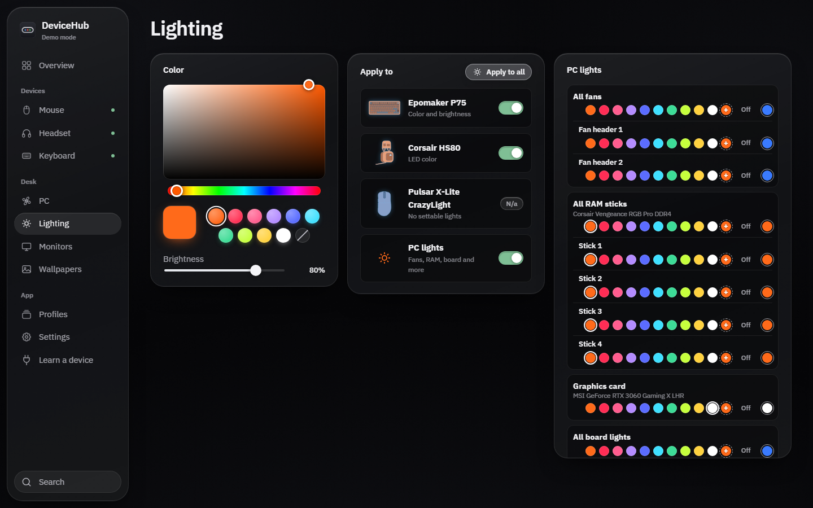

<h1 align="center">DeviceHub</h1>

One Windows app for your mouse, headset, keyboard, monitors, webcam and PC lights, instead of a vendor app for each.

  <a href="https://github.com/Dsmjr2/DeviceHub-download/releases/latest/download/DeviceHub-Setup.exe"><b>⬇ Download DeviceHub-Setup.exe</b></a>
  &nbsp;·&nbsp; 78 MB &nbsp;·&nbsp; Windows 11

## Install

1. **Download** `DeviceHub-Setup.exe` (link above).
2. **Double-click it.** If Windows shows a blue "Windows protected your PC" box, click **More info**, then **Run anyway**.
3. **DeviceHub opens.** Plug in your devices; the ones it knows show up by themselves. Next time, start it from the
   Desktop or Start menu shortcut.

Nothing else needs downloading: Node.js comes inside, and so does Equalizer APO for headset, speaker and mic EQ
(DeviceHub installs it on your click; tick your headset in its setup and restart once). Updates are signed, and
DeviceHub asks before installing one.

To remove it: Windows **Settings > Apps > Installed apps > DeviceHub > Uninstall**, or **Settings > Uninstall** inside
DeviceHub. Your backups and settings are kept in Documents\DeviceHub backups.

## What it works with

**With any device of its kind, nothing to set up:**

- **Keyboards:** any keyboard that supports **VIA**: keys on every layer, knob, macros, lighting
- **Headsets:** any USB or Bluetooth headset: volume, mic, EQ; battery over Bluetooth
- **Logitech G:** any Logitech G mouse, keyboard or headset on its own channel: battery and settings
- **Corsair:** any Corsair mouse or keyboard: battery, polling rate and firmware (read only)
- **Mice:** any mouse: Windows' pointer speed, scrolling and double-click
- **Monitors:** brightness, contrast, color and volume on monitors with DDC/CI (most do)
- **Webcams:** picture settings
- **Lights:** USB lights and Windows Dynamic Lighting devices; fans, RAM, graphics card and board lights through the
  OpenRGB inside DeviceHub (board lights take one click to set up)
- **Batteries:** Bluetooth devices show their battery

**Fully supported models:** Pulsar X-Lite CrazyLight mouse, Corsair HS80 RGB Wireless headset (no iCUE needed) and
Epomaker P75 keyboard.

**Ready-made drivers** for many Logitech, Razer, Corsair, SteelSeries, HyperX, ASUS ROG, Glorious, ROCCAT, Keychron,
Wooting, Audeze, Turtle Beach and Lenovo Legion devices. DeviceHub finds the right one (press **Install** if it asks),
then **Turn on settings** once: it tests each setting before you use it. When yours works, **Works on my device**
tells others.

**Also inside:** a PC page with temperatures and fan speeds, a Laptop page with battery health and power modes,
wallpapers, and profiles that switch every device at once (also when a game starts). Every change is backed up first.

## A device it does not know yet?

In DeviceHub, **Learn a device** (in the sidebar) makes a driver while you change settings in the maker's app, or
**Learn it for me** does the clicking. If it cannot finish, it can send the recordings so a driver can be made.

You can also open the installed DeviceHub folder (`%USERPROFILE%\DeviceHub`) in **Claude Code** and ask it to set up
your devices; DeviceHub's **Copy prompt** button gives you a ready prompt.

Prefer a zip? <a href="https://github.com/Dsmjr2/DeviceHub-download/releases/latest/download/DeviceHub-setup.zip">DeviceHub-setup.zip</a> (unzip, then run Install DeviceHub.bat).
